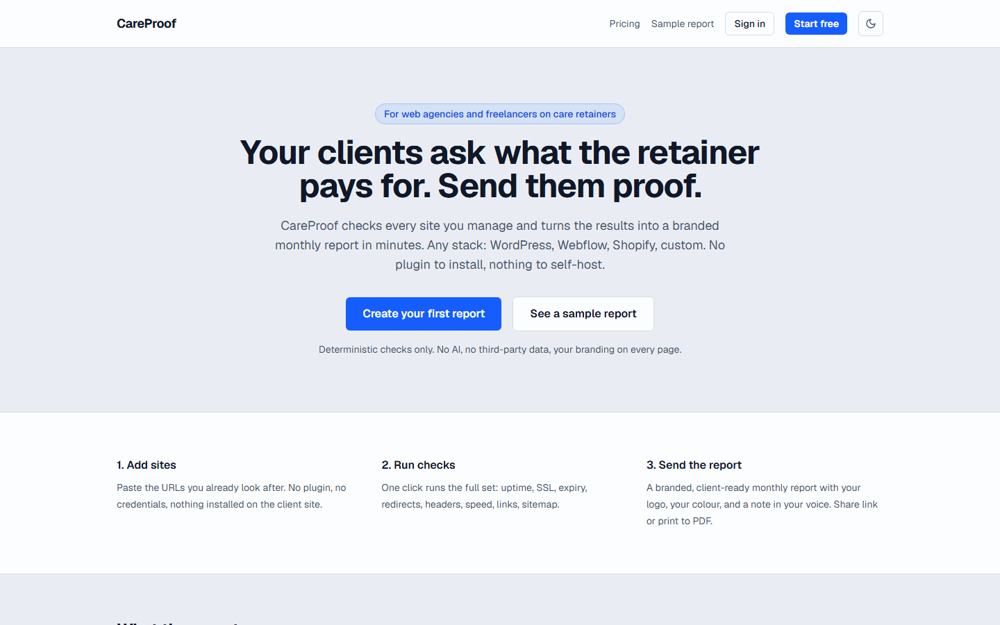
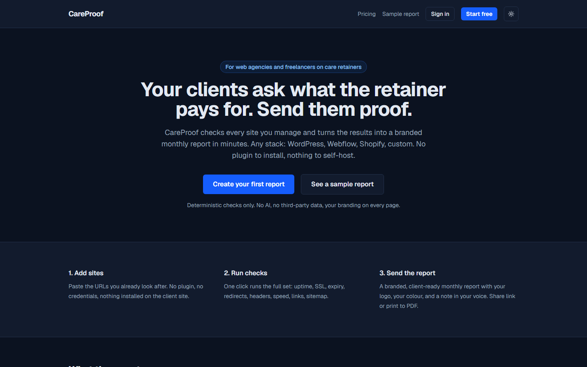
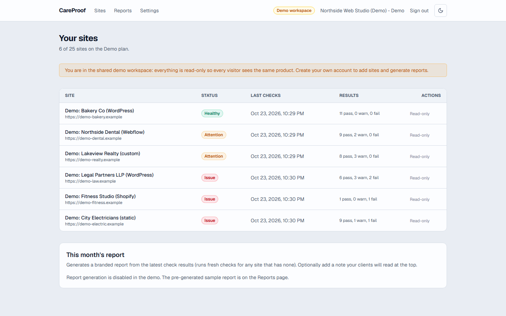
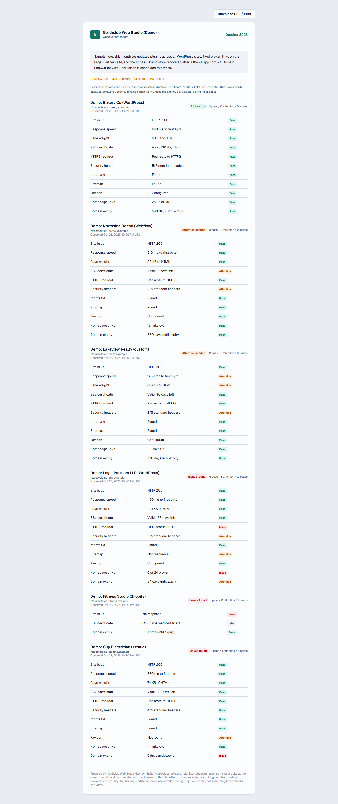

# CareProof

Branded monthly website-care reports for web agencies: prove what the retainer pays for, on every client site, across every stack.

[](https://careproof-tau.vercel.app)
[](https://github.com/devtechedge/careproof/actions/workflows/ci.yml)
[](https://nextjs.org)
[](https://www.typescriptlang.org)
[](LICENSE)

## Live Demo

https://careproof-tau.vercel.app

> Real production deployment with a real Postgres database (Neon), not a mock.
> Explore the shared read-only demo workspace with `demo@careproof.test` / `demo-password-1`,
> or create your own free account and add real sites. Checks run against public
> pages only, with hard timeouts, and no site credentials are ever requested.

## Screenshots

| Landing | Landing (dark) |
|---|---|
|  |  |

| Dashboard (demo) | Client report |
|---|---|
|  |  |

## What it does

Agencies charge monthly care retainers and then struggle to show clients what the money maintains. Incumbent reporting is WordPress-only or uptime-only. CareProof checks any public URL (WordPress, Webflow, Shopify, custom) and turns the results into a branded, client-ready report in minutes.

- Eleven deterministic checks per site: uptime, response speed, page weight, TLS certificate expiry, HTTPS redirect, security headers, robots.txt, sitemap, favicon, sampled homepage links, and domain expiry via the public RDAP registry.
- White-label on every plan: agency name, accent color, logo.
- Reports are point-in-time snapshots with per-site observation timestamps and a staleness warning when data is old.
- Share links are unlisted and revocable; published reports are immutable.
- Flat pricing tiers with server-side plan limits (Starter $19 / Studio $49 / Agency $99).
- Outbound requests run through a centralized network guard: validated destinations, pinned DNS resolution, per-hop redirect checks, blocked private and metadata addresses.
- Light and dark themes, print-to-PDF ready report layout.

## Stack

| Layer | Choice |
|---|---|
| Framework | Next.js 16 (App Router, server actions) |
| Language | TypeScript (strict) |
| UI | React 19, Tailwind CSS 4 |
| Database | PostgreSQL on Neon, Prisma 7 (pg adapter) |
| Auth | scrypt password hashing, hashed DB sessions, HttpOnly cookies |
| Tests | Vitest (unit + service), Playwright (browser smokes) |

## Quick start

Requires Node 22+ and a Postgres database (a free Neon project works).

```
npm install
cp .env.example .env          # fill in your Postgres URLs and a session pepper
npx prisma db push            # use the unpooled URL for DDL
npm run dev                   # http://localhost:3000
```

Optional: seed a labelled read-only demo workspace with `npm run db:seed` (refuses to run against a database named `careproof` unless you set `ALLOW_PROD_SEED=1`).

Run the test suite with `npm test` (unit and service tests against a dedicated test database, 107 tests) and the browser smokes with `npx playwright test`.

## Security

Tenant data is scoped per account at the query layer, cross-account access is tested, sessions rotate on password change, and every outbound check runs through the SSRF guard described above. See `SECURITY.md` for the honest threat model, including what is intentionally not implemented yet (email verification, password reset).

## License

[MIT](LICENSE)
